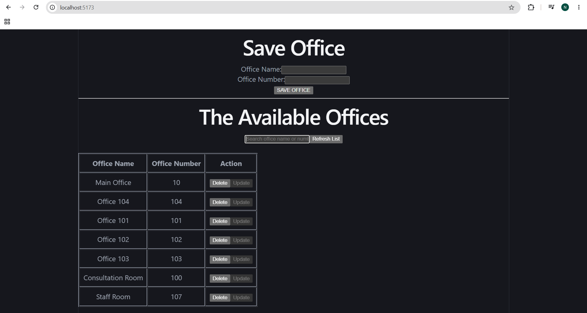

# Clinic Management System

This is my Web Technology assignment developed using React for the frontend, Spring Boot for the backend, and PostgreSQL for the database.

## Project Screenshot

Below is a screenshot of my running Clinic Management System showing the office management page.

## Features

- Save a new office.
- Display all available offices.
- Search for offices by office name or office number.
- Delete an office from the list.

## Technologies Used

- React JS
- Java Spring Boot
- PostgreSQL
- Axios
- HTML and CSS

## How to Run the Project

### Backend

1. Open the `backend` folder in a Java IDE.
2. Make sure PostgreSQL is running.
3. Create a PostgreSQL database named `Clinic`.
4. Configure the database username and password in `application.properties`.
5. Run the Spring Boot application.

The backend runs on port `1014`.

### Frontend

1. Open the `frontend` folder in VS Code.
2. Open the terminal.
3. Run `npm install`.
4. Run `npm run dev`.
5. Open the localhost link displayed in the terminal.

On Windows PowerShell, `npm.cmd run dev` can also be used.

## Project Structure

- `backend` — Spring Boot backend
- `frontend` — React frontend
- `screenshots` — Screenshot of the running application

## Assignment Information

The main task was to display available offices, implement searching and deleting.
